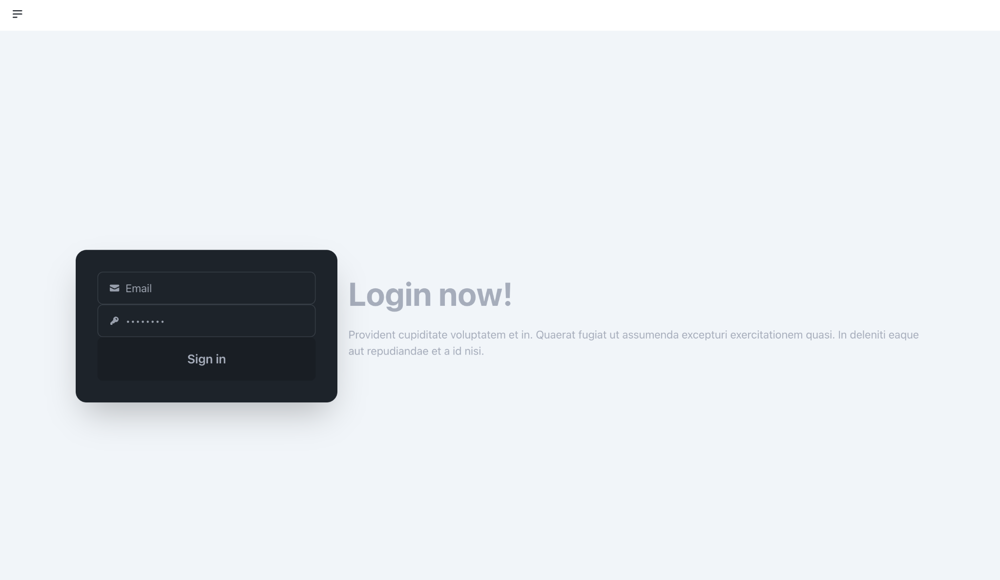
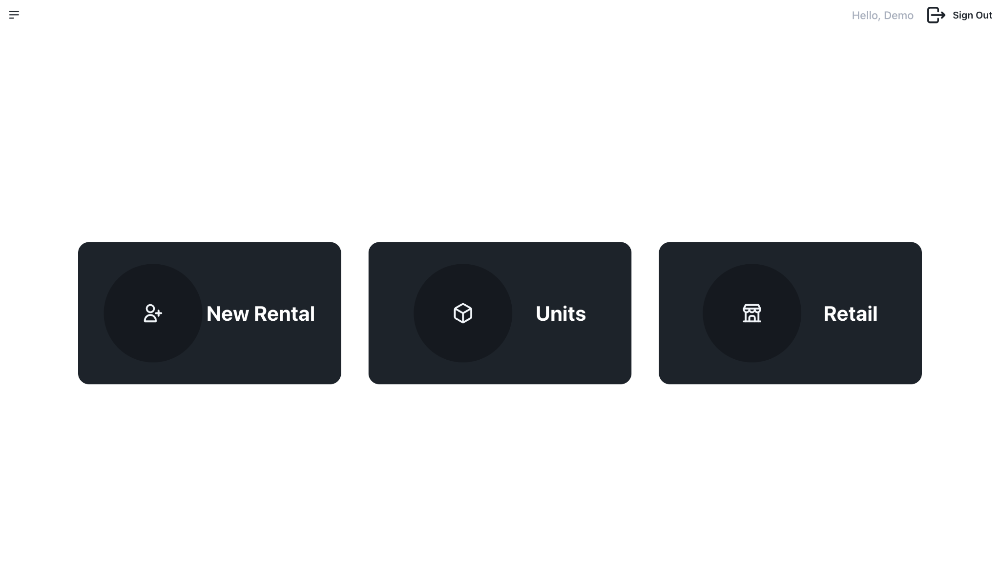
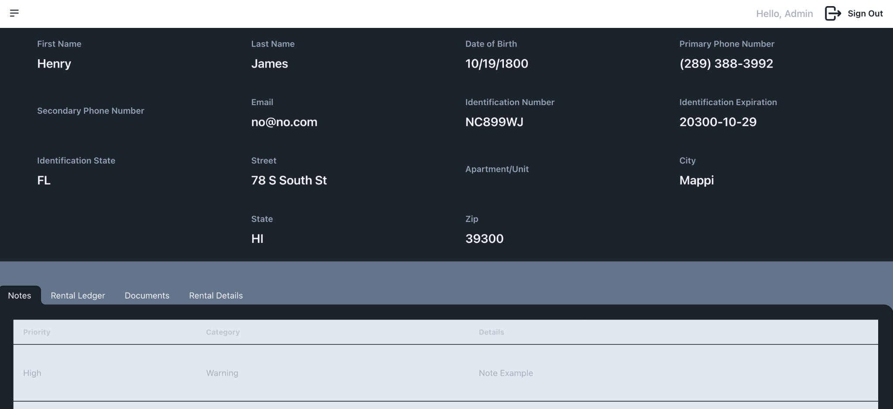
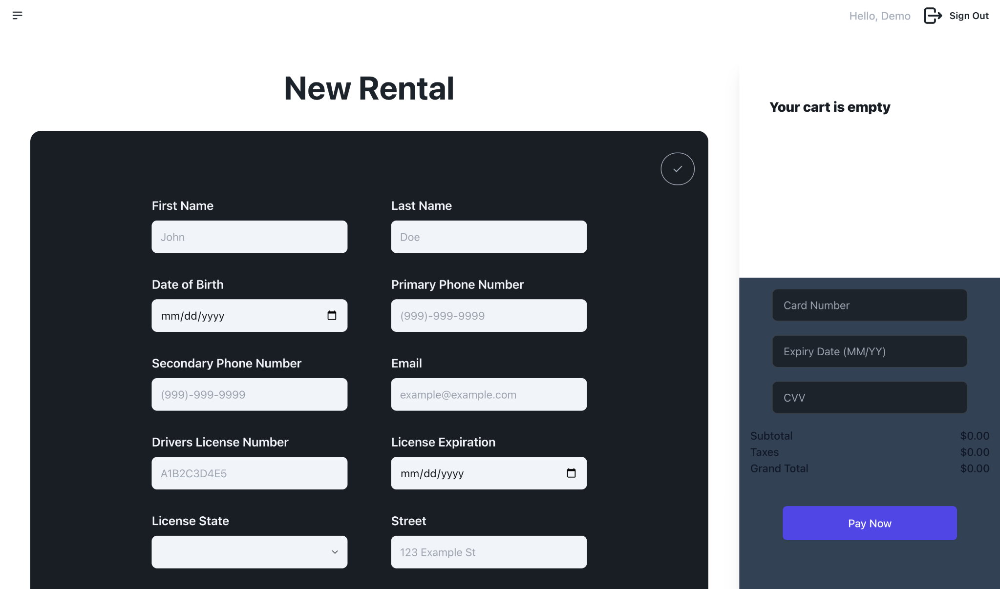
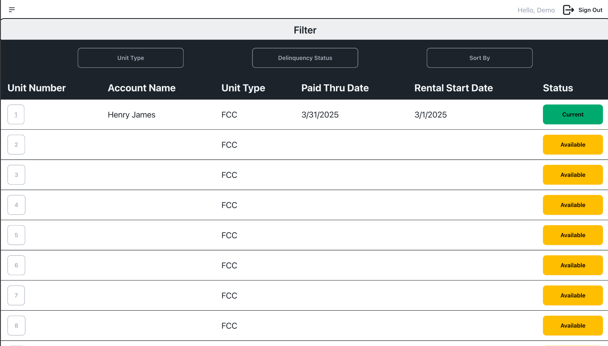

# Storage Management System

## Overview

A full-stack storage management application built to manage storage units, customer accounts, rental agreements, payment records, and customer documents.

The application provides a centralized interface for managing storage facility operations, including unit availability, customer information, rental details, and account activity.

## Screenshots

### Login


### Dashboard


### Customer Account


### New Rental


### Unit Management


## Features

- **Dashboard:** Centralized navigation for storage management operations.
- **Customer Management:** Add and manage customer accounts and personal information.
- **Unit Management:** View storage units and track their availability and rental status.
- **Rental Management:** Create and manage customer rental agreements.
- **Rental Ledger:** Maintain and view rental and payment records.
- **Customer Notes:** Add and delete notes associated with individual customer accounts.
- **Document Management:** Upload and manage customer documents.
- **Move-Out Management:** Track customer move-out information.
- **Account Details:** View customer contact information, identification details, and rental information.

## Technology Stack

| Technology | Purpose |
|---|---|
| React | Frontend user interface |
| JavaScript | Application logic |
| Node.js | Backend runtime |
| Express.js | REST API |
| PostgreSQL | Relational database |
| bcrypt | Password hashing |
| Multer | File uploads |

## Project Structure

```text
storage-app/
├── frontend/
│   ├── public/
│   └── src/
├── backend/
│   └── server.js
├── screenshots/
│   ├── login.png
│   ├── dashboard.png
│   ├── account.png
│   ├── new-rental.png
│   └── units.png
├── .gitignore
└── README.md
```

## Getting Started

### Prerequisites

- Node.js and npm
- PostgreSQL
- Git

### 1. Clone the repository

```bash
git clone https://github.com/eddiestcc/storage-app.git
cd storage-app
```

### 2. Install dependencies

Install frontend dependencies:

```bash
cd frontend
npm install
```

Install backend dependencies:

```bash
cd ../backend
npm install
```

### 3. Configure PostgreSQL

The backend requires a locally configured PostgreSQL database.

Before running the application:

1. Install and configure PostgreSQL.
2. Create the required database.
3. Set up the necessary database tables.
4. Configure the database connection credentials in the backend.

**Important:** The demo login bypasses database authentication, but the remaining application functionality still requires a working PostgreSQL connection and the appropriate database tables.

### 4. Start the backend

From the `backend` directory:

```bash
node server.js
```

The backend runs on:

```text
http://localhost:3001
```

### 5. Start the frontend

Open another terminal:

```bash
cd frontend
npm start
```

The React application should open at:

```text
http://localhost:3000
```

## Demo Credentials

The application includes a demo login:

| Field | Value |
|---|---|
| Email | demo@example.com |
| Password | Demo123 |

**Note:** The demo login bypasses database authentication. Other application features still depend on the PostgreSQL database.

## What I Learned

Building this project gave me practical experience developing a full-stack CRUD application and working with the different components of a web application.

- **CRUD Operations:** Implemented functionality to create, retrieve, update, and delete application records.
- **Customer Management:** Built functionality to add and manage customer accounts.
- **Account Management:** Implemented the ability to add and delete customer notes and documents within individual accounts.
- **File Management:** Practiced handling file uploads and managing stored documents using Multer and the backend file system.
- **Database Integration:** Worked with PostgreSQL to store and retrieve customer, rental, payment ledger, and unit information.
- **REST API Development:** Used Node.js and Express to build API endpoints connecting the frontend to the backend.
- **Frontend and Backend Integration:** Connected React components to backend API endpoints to retrieve and display application data.
- **Application Structure:** Gained experience organizing a project into separate frontend and backend directories.

## Future Improvements

- **Payment Integration:** Integrate a payment provider such as Stripe to allow customers to make rental payments directly through the application.
- **Authentication and Authorization:** Strengthen authentication, implement secure session management, and introduce role-based access controls.
- **Input Validation and Error Handling:** Improve validation and error handling across frontend forms and backend API endpoints.
- **Reporting:** Add reporting features for rental income, outstanding balances, and unit occupancy.
- **Automated Testing:** Implement frontend and backend tests to improve reliability and maintainability.
- **Responsive Design:** Further improve the user experience across desktop, tablet, and mobile devices.

## Disclaimer

This project is intended for educational and portfolio purposes. It demonstrates full-stack application development using React, Node.js, Express, and PostgreSQL.
